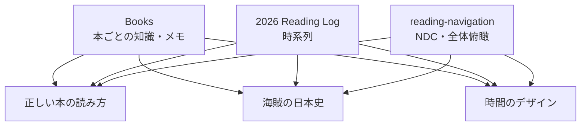

# 読書ノートの保存構造とReading Log運用

## 結論

読書ノートは、まず大きく・単純な構造で運用する。

- `Books` 配下は基本的にフラットに保つ
- 日付や週によって本ノート自体をフォルダ分けしない
- 分類・時系列・進捗は別のナビゲーションノートで表現する
- Reading Logは最初から細分化せず、1つのノート内を週単位で区切る
- 実際に不便が発生してから、月単位・週単位などへ分割する
- ノートの作成日時・更新日時は `Update time on edit` で自動管理する

基本方針は、

> 集約 → 運用 → 摩擦が出たら分割

とする。

---

## Booksのフォルダ構造

現在は、

```text
21_Reading/
└─ Books/
   ├─ 正しい本の読み方.md
   ├─ 移動する人はうまくいく.md
   ├─ 海賊の日本史.md
   ├─ 時間のデザイン.md
   └─ ...
```

のように、各本を `Books` 直下へ置いている。

この構造を当面維持する。

### 週単位フォルダへ分割しない

候補として、

```text
Books/
├─ 20261004-20261010/
├─ 20261011-20261017/
└─ ...
```

のような整理方法も考えたが、採用しない。

理由は、**本そのものと、その本を読んだ時期は別の情報だから**。

例えば同じ本を、

- 10月8日に読み始める
- 10月10日に読む
- 10月12日に続きを読む
- 数か月後に再読する

ということがある。

この場合、日付フォルダへ本を所属させると、

- 最初に読んだ週なのか
- 最も読んだ週なのか
- 読み終わった週なのか

が曖昧になる。

したがって、

```text
Books/正しい本の読み方.md
```

というノート自体の場所は固定し、その内部へ時系列を積み上げる。

例：

```markdown
## 2026-10-08

第1章を読む。

## 2026-10-10

続きを読む。

## 2026-10-12

再度確認。
```

---

## 「保存場所」と「分類」を分離する

基本的な考え方は次の通り。

| 役割 | 手段 |
|---|---|
| 本そのものを保存する | `Books` |
| NDCなどで分類する | `reading-navigation` |
| いつ読んだか管理する | `Reading Log` |
| その本について何を考えたか | 各Bookノート |
| ファイルの作成・更新日時 | Properties |

File Explorerを「完成された本棚」として整理しようとしない。

イメージとしては、

> File Explorer = 倉庫  
> navigation note = 本棚・展示棚

と考える。

Obsidianでは、フォルダ構造だけで意味を表現する必要はない。

---

## 将来Booksが大規模になった場合

数百冊〜数千冊になり、File Explorer上で扱いづらくなった時点でフォルダ分割を検討する。

その場合も、日付よりは既存のNDC分類に合わせる方が自然。

```text
Books/
├─ 000-099/
├─ 100-199/
├─ 200-299/
├─ 300-399/
├─ ...
└─ 900-999/
```

ただし、現時点では分割しない。

「将来増えるから」という理由だけで先に複雑化しない。

---

## Reading Logの役割

Reading Logは、各本の詳細を書く場所ではなく、

> いつ、どのような流れで本を読んだか

を見るための時系列インデックスとして扱う。

役割を整理すると、

```text
Books
↓
何を読んだか・何を考えたか

Reading Log
↓
いつ、どのような流れで読んだか

reading-navigation
↓
全体のどこをどれくらい進めているか
```

となる。

---

## Reading Logの粒度

週ごとに別ノートを作る方法と、1つのノート内部を週単位で区切る方法を比較した。

### 採用する方法

最初は、

```text
2026 Reading Log.md
```

という大きなノートを1つ作る。

内部を週単位で区切る。

例：

```markdown
# 2026 Reading Log

## 2026-10-04 – 2026-10-10

- [[正しい本の読み方]]
- [[移動する人はうまくいく]]
- [[海賊の日本史]]
- [[小相撲殺人事件]]

### メモ

- 000–099を多めに進めた
- 1冊あたりの読書量より冊数を回すことを優先
- 音声入力 → AI要約の流れを試した

---

## 2026-10-11 – 2026-10-17

- [[...]]
```

### 週ごとに別ノートを作らない理由

週単位なら年間約52ファイル増える。

Reading Logが、

- 本へのリンク
- 冊数
- 短い振り返り

程度なら、52ファイルへ分割するメリットは小さい。

詳細な情報は各Bookノートに保存するため、Reading Logは薄く保つ。

---

## Reading Logを分割する基準

最初から最適な粒度を予測しない。

次の順番で分割する。

```text
1. 年単位
   2026 Reading Log.md

        ↓ 長すぎる

2. 月単位
   2026-10 Reading Log.md
   2026-11 Reading Log.md

        ↓ それでも扱いづらい

3. 週単位
   2026-10-04--2026-10-10.md
```

つまり、

> でっかく作ってから細分化する。

実際に検索性・編集性・表示速度などで摩擦が発生したときに初めて分割する。

---

## Update time on edit

Obsidianの `Update time on edit` を利用し、ノートの作成日時・最終更新日時を自動管理する。

典型的にはPropertiesへ、

```yaml
---
created: 2026-10-10T01:45
updated: 2026-10-10T02:08
---
```

のように保存する。

### `created`

ノートを作成した日時。

基本的には一度設定された後は変更しない。

### `updated`

ノートを最後に編集した日時。

本文を変更すると自動更新する。

重要なのは、`updated` を「最後に本を読んだ日時」と解釈しないこと。

例えば誤字を1文字修正しただけでも更新される。

したがって、

```text
読書した日
→ 本文の日付見出し

ノートを作成した日
→ created

ファイルを最後に編集した日
→ updated
```

と分離する。

---

## Update time on edit の設定

### Folder to exclude of all updates

プラグインによる日時更新から除外したいフォルダを指定する。

特に、

```text
Templates
```

は除外候補。

テンプレート自体に作成日時・更新日時が書き込まれると、その値を新規ノートへコピーしてしまう可能性がある。

### Minimum number of minutes between update

`updated` を更新する最短間隔。

現在の、

```text
1
```

で基本的に問題ない。

頻繁な更新による不要な書き換えを抑えるための設定。

### Date format

候補：

```text
yyyy-MM-dd'T'HH:mm
```

出力：

```text
2026-10-10T02:04
```

時刻不要なら、

```text
yyyy-MM-dd
```

も可能。

ただしZK・Dataview・Bases・Quartzなどで後から利用する可能性を考えると、

```text
yyyy-MM-dd'T'HH:mm
```

のISO形式を基本とする。

---

## 推奨構造

現段階では次の程度に留める。

```text
21_Reading/
├─ Books/
│  ├─ 正しい本の読み方.md
│  ├─ 移動する人はうまくいく.md
│  ├─ 海賊の日本史.md
│  └─ ...
│
├─ Reading Log/
│  └─ 2026 Reading Log.md
│
└─ reading-navigation.md
```

関係は、



同じBookノートへ複数の入口を作る。

Bookノート自体の保存場所は動かさない。

---

## Decisions

- `Books` は当面フラット構造を維持する
- 週単位の日付フォルダへBookノートを移動しない
- 時系列管理はReading Logへ分離する
- Reading Logは最初は年単位の1ノートとする
- Reading Log内部を週見出しで区切る
- 必要になった場合のみ月・週単位へ細分化する
- NDCなどの分類は `reading-navigation` 側で行う
- `created` / `updated` は `Update time on edit` に任せる
- 読書日と `updated` は別物として扱う
- テンプレートフォルダは更新対象から除外する方向

## Rejected / Deferred

- `Books/20261004-20261010/` のような週単位フォルダ
- 最初からReading Logを週単位52ノートへ分割する
- 将来の規模を予測して現時点でBooksを細かく分類する

いずれも必要性が生じた段階で再検討する。

## Outstanding issues

- `2026 Reading Log.md` の実際のテンプレート設計
- Reading Logへ記録する情報量
- NDCごとの読書量・冊数をReading Log側にも持たせるか
- Dataview / BasesでReading Logを半自動生成するか
- Quartz上で `created` / `updated` をどの程度表示するか

## 基本原則

> フォルダは保存場所として単純に保つ。  
> 意味・分類・時系列はリンクとノートで表現する。

> 最初から細かく分割しない。  
> 大きく作り、実際の摩擦が確認できてから細分化する。

元スレッドID: `6ac91e84-1fbc-83ec-8937-288fa07a4fb9`

